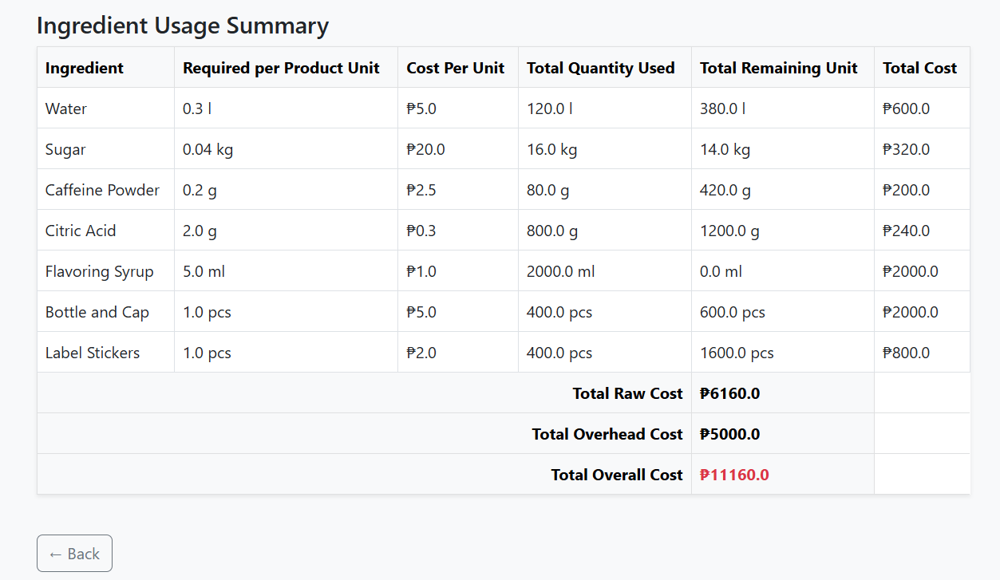
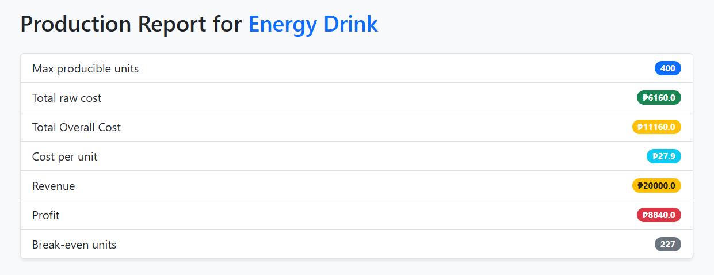

<div align="center">


**A Flask web app that calculates the cost of producing a product and reports revenue, profit, and break-even units.**

[Overview](#overview) · [Features](#features) · [Getting Started](#getting-started) · [Sample Run](#sample-run) · [Team](#team)

</div>

---

## Overview

The Product Cost Calculator computes production cost from ingredient usage, unit conversions, fixed overheads, and the selling price, then generates a production report. It was submitted as a requirement for the **CPE300 Optimization Techniques** course.

## Features

**Inputs**

- Product name
- Selling price per unit
- Fixed overhead cost
- Ingredients: name, available quantity, required quantity per unit, unit, and cost per unit

**Outputs**

- Maximum producible units
- Total raw cost and total cost (including fixed overhead)
- Cost per unit
- Revenue and profit
- Break-even units
- Ingredient usage and remaining quantities

## Tech Stack

| Layer | Technology |
|---|---|
| Backend | Python, Flask |
| Frontend | HTML templates, JavaScript |
| Tests | Python `unittest` |

## Project Structure

```text
Product-Calculator/
├── src/
│   ├── app.py                 # Flask entry point
│   ├── routes/                # compute, input, and output routes
│   ├── utils/                 # helpers and input validation
│   ├── templates/             # index.html, result.html
│   └── tests/                 # test_compute, test_input_routes
├── static/                    # Sample output images and scripts
└── Group-Report_FInal_Project_CPE300.pdf
```

## Getting Started

**Prerequisites:** Python and Flask.

```bash
git clone https://github.com/nixxinix/Product-Calculator.git
cd Product-Calculator
pip install flask
cd src
python app.py
```

**Run the tests** from the repository root:

```bash
python -m unittest src.tests.test_input_routes
python -m unittest src.tests.test_compute
```

## Sample Run

**Example product:** Energy Drink, a recipe-based product used to demonstrate production costing.

- **Selling price:** ₱60
- **Fixed overhead:** ₱8,000

| Ingredient | Available | Required per unit | Unit | Cost per unit (₱) |
|---|---|---|---|---|
| Water | 500 L | 0.3 | L | 5.00 |
| Sugar | 30 kg | 0.04 | kg | 20.00 |
| Caffeine Powder | 500 g | 0.2 | g | 2.50 |
| Citric Acid | 2000 g | 2 | g | 0.30 |
| Flavoring Syrup | 2000 mL | 5 | mL | 1.00 |
| Bottle and Cap | 1000 pcs | 1 | pcs | 5.00 |
| Label Sticker | 2000 pcs | 1 | pcs | 2.00 |

**Output**




## Team

| Member | GitHub |
|---|---|
| Emmanuel, Tammy Buenafe | |
| Garcia, John Michael | [@jaygarciaaa](https://github.com/jaygarciaaa) |
| Peña, John Rhey D. | |
| Rivera, Bernie Jr. | |
| Samarita, King Rey Mark | [@nixxinix](https://github.com/nixxinix) |

The full group report is in [Group-Report_FInal_Project_CPE300.pdf](Group-Report_FInal_Project_CPE300.pdf).

---

<div align="center">
<sub>Part of the <a href="https://github.com/nixxinix">nixxinix</a> project portfolio</sub>
</div>
